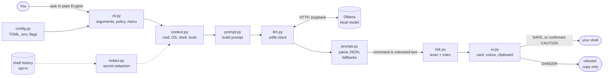

# ShellSage

**Plain English in, shell command out, with a deterministic risk engine between the model and your shell. Runs entirely on your machine via [Ollama](https://ollama.com).**

[](https://github.com/Kavin-Re/shell-sage/actions/workflows/ci.yml)


[](LICENSE)

```console
$ sage find all log files larger than 50MB

  $ find . -type f -name '*.log' -size +50M

  Searches the current directory tree for regular files ending in .log that are larger than 50 MiB.

  risk: SAFE (no risk rule matched)

  [r]un  [e]dit  [c]opy  e[x]plain  [q]uit >
```

ShellSage asks a local model for a command, **explains it**, **grades its risk with rules that do not depend on the model**, and only then lets you run, edit or copy it. A language model will sooner or later suggest `rm -rf` in the wrong place; the interesting engineering problem is what stands between that suggestion and your disk. That is what most of this repository is about.

## Contents

- [Why it exists](#why-it-exists)
- [Quick start](#quick-start)
- [Usage](#usage)
- [Demo](#demo)
- [Safety model](#safety-model)
- [Privacy](#privacy)
- [Architecture](#architecture)
- [Configuration reference](#configuration-reference)
- [Shell hook](#shell-hook)
- [Development](#development)
- [Limitations](#limitations)
- [Roadmap](#roadmap)

## Why it exists

| | |
|---|---|
| **Offline by default** | Talks to Ollama on `127.0.0.1`. No cloud API, no account, no telemetry. `sage doctor` warns if you point it at another host. |
| **Zero runtime dependencies** | Standard library only (`urllib`, `tomllib`, `shlex`, `argparse`). Nothing to audit but this repository. (Python 3.10 needs `tomli` to read a config file.) |
| **A real risk engine** | A quote-aware lexer and rule-based classifier, not a keyword list. `echo "rm -rf /"` is SAFE; `X="a b" 'r'm -r"f" /*` is DANGER. |
| **The model cannot overrule the engine** | The model's own risk label can raise the level, never lower it. DANGER commands are not executed by ShellSage at all. |
| **Transparent** | `--show-prompt` prints exactly what would be sent to the model. Shell history is opt-in and redacted. |
| **Usable without a model** | `sage --check "<command>"` grades any command offline and sets the exit status, so it works in scripts and hooks. |

## Quick start

Requirements: Linux or macOS, Python 3.10+, and [Ollama](https://ollama.com/download).

```bash
# 1. Get a model (about 2 GB; any model you have pulled works, see --model)
ollama pull qwen2.5-coder:3b

# 2. Install ShellSage
git clone https://github.com/Kavin-Re/shell-sage.git
cd shell-sage
./install.sh          # uses pipx if present, otherwise pip --user; no sudo

# 3. Verify the setup
sage doctor

# 4. Ask
sage "show the ten largest files in this directory"
```

Manual install is one line: `pipx install .` (or `python3 -m pip install --user .`).
To try it without installing anything: `python3 src/main.py --check "rm -rf ~"`.

## Usage

```text
sage [options] <what you want to do>
sage --explain "<command>"        explain an existing command
sage --check "<command>"          grade a command offline (no model call)
sage doctor                       check Ollama, the model and your configuration
sage config                       print the effective configuration
sage shell-init bash|zsh          print the shell hook
```

| Option | Effect |
|---|---|
| `-n`, `--dry-run` | Show the suggestion; never execute. When stdout is a pipe, the bare command is written to stdout (`cmd=$(sage -n ...)`). |
| `-y`, `--yes` | Execute without asking. **Honoured only for SAFE commands**; anything else is refused (exit 3) or falls back to the menu. |
| `--json` | Machine-readable result on stdout (`command`, `explanation`, `risk`, `findings`). Implies `--dry-run`. |
| `-x`, `--explain CMD` | Explain a command you already have, part by part, plus the local risk grade. |
| `-c`, `--check CMD` | Risk engine only. Exit status: `0` SAFE, `10` CAUTION, `20` DANGER. |
| `-m`, `--model`, `--host`, `--timeout` | Override the model tag, Ollama URL or request timeout for one run. |
| `--history N` / `--no-history` | Include the last N redacted history lines as context, or force history off. |
| `--show-prompt` | Print the exact system prompt and prompt, then exit without calling the model. |
| `--color auto\|always\|never` | Colour control. `auto` respects [`NO_COLOR`](https://no-color.org), `TERM=dumb` and non-TTY output. |

The interactive menu:

| Key | Action |
|---|---|
| `r` | Run. SAFE runs immediately, CAUTION asks `y/N`, DANGER is refused. |
| `e` | Edit the command: in place with GNU readline; with libedit (macOS default) you type a replacement. The edited text is graded again from scratch. |
| `c` | Copy to the clipboard (`wl-copy`, `xclip`, `xsel`, `pbcopy`, `clip.exe`), or print it if none is found. |
| `x` | Ask the model for a part-by-part explanation. |
| `q` | Quit. Pressing Enter alone never runs anything. |

Exit status: `0` success (or the status of the command you ran), `1` error, `2` usage/configuration error, `3` execution refused by the risk policy, `130` interrupted.

A task containing words that start with `-` goes after `--`: `sage -- list files -la style`.

## Demo

> **Illustrative transcript.** The *model replies* below (command and explanation text) were canned for this README: they were served by the fake Ollama used in the test suite, not by a live model, and a real model will word things differently or pick a different command. Everything else is real program output: the layout, the risk verdicts and reasons, the confirmation and the refusal. The one-line `asking <model> ...` status and the output of the executed command are elided. The same applies to the screenshot-style block at the top of this page.

A CAUTION command needs an explicit yes:

```console
$ sage delete the build directory and node_modules

  $ rm -rf build node_modules

  Recursively removes the build and node_modules directories.

  risk: CAUTION
    ! recursively deletes files permanently (no trash, no undo) [destructive]

  [r]un  [e]dit  [c]opy  e[x]plain  [q]uit > r
  CAUTION - run it anyway? [y/N] y
```

The model called this one "caution". The engine disagreed, and the engine wins:

```console
$ sage install docker the quick way

  $ curl -fsSL https://get.docker.com | sudo sh

  Downloads the Docker convenience script and runs it as root.

  risk: DANGER
    ! pipes data downloaded from the network straight into `sh` (remote code execution without review) [network-exec]
    ! runs with elevated privileges (sudo) [privileged]

  [r]un  [e]dit  [c]opy  e[x]plain  [q]uit > r
  refused: ShellSage does not execute DANGER commands. Read the reasons above;
  if you are certain, [c]opy it and run it yourself.
  [r]un  [e]dit  [c]opy  e[x]plain  [q]uit > c
  copied to clipboard (wl-copy)
```

Explaining a command you found somewhere:

```console
$ sage --explain "tar -xzvf backup.tar.gz -C /opt"

  $ tar -xzvf backup.tar.gz -C /opt

  risk: SAFE (no risk rule matched)

  Extracts the gzip-compressed archive backup.tar.gz into /opt, listing each file.

    tar               archive tool
    -x                extract
    -z                decompress with gzip
    -v                list files as they are processed
    -f backup.tar.gz  read this archive file
    -C /opt           change to /opt before extracting

  model warning: Existing files in /opt with the same names are overwritten.
```

The next block involves no model at all, so it is **exact, reproducible output** (`NO_COLOR=1`):

```console
$ sage --check "git push --force origin main"; echo "exit $?"

  $ git push --force origin main

  risk: CAUTION
    ! git push rewrites or deletes history on the remote [vcs]

exit 10

$ sage --check ':(){ :|:& };:'; echo "exit $?"

  $ :(){ :|:& };:

  risk: DANGER
    ! defines a function that keeps spawning copies of itself (fork bomb) - this exhausts the process table and freezes the machine [fork-bomb]

exit 20

$ sage --check "sudo sh -c 'echo hi > /dev/sda'"; echo "exit $?"

  $ sudo sh -c 'echo hi > /dev/sda'

  risk: DANGER
    ! redirects output onto the raw device /dev/sda, destroying its contents [device-write]
    ! runs with elevated privileges (sudo) [privileged]

exit 20
```

## Safety model

### Threat model

The model is treated as an **untrusted text generator**. It can be wrong, it can be confused by ambiguous requests, and its input can be poisoned (a hostile file name, a line in your shell history). So:

1. Nothing the model returns is executed without being shown first.
2. The risk verdict is computed locally by deterministic code ([`risk.py`](src/shellsage/risk.py)). It never consults the model.
3. The model's own `risk` field is only allowed to make the verdict *worse*.
4. Control characters and ANSI escapes in model output are rendered visibly (`\x1b[2K`) and flagged, so a reply cannot repaint your terminal to show one command and run another.
5. Editing a command re-grades it; the old verdict is discarded.

### Levels

| Level | Meaning | `[r]un` | `--yes` |
|---|---|---|---|
| **SAFE** | No rule matched. | runs | runs |
| **CAUTION** | Changes state, needs privileges, or cannot be fully inspected. | asks `y/N` (default No) | refused when not on a terminal (exit 3); menu otherwise |
| **DANGER** | Can destroy a system, disk or home directory, or runs code from the network. | **refused** (copy only) | **refused** |

`SAFE` means "no rule matched". It is not a proof of harmlessness. Read the command.

If you really want ShellSage to be able to run DANGER commands, set `allow_danger = true` under `[safety]` in the config file. Even then you must type the phrase `yes, run it`. There is deliberately no environment variable or flag for this, so a script or a poisoned environment cannot switch it on.

### How a command is analysed

1. **Lex** the line into words and operators, honouring single quotes, double quotes, backslashes, comments, `$(...)`, backticks, `<(...)`, `${...}` and fd redirections such as `2>&1`.
2. **Recurse** into every command substitution and into the argument of `sh -c`, `bash -lc`, `eval`, `su -c`, `watch`, `ssh host '...'`, `find -exec ... ;` and `alias x='...'`.
3. **Unwrap** `sudo`, `doas`, `env`, `nohup`, `nice`, `timeout`, `xargs`, `command`, `exec`, `busybox` and friends, and skip leading `VAR=value` assignments, to find the program that really runs. Each word is unquoted with `shlex`, so `'r'm`, `r\m` and `/bin/rm` are all `rm`.
4. **Apply rules** to the program, its flags, its path operands and its redirections. Paths are normalised first (`//`, `/./`, `/home/../`, `$HOME/`, `~/*`, `/{bin,etc}`).
5. **Look at pipelines as a whole**: a shell or interpreter reading stdin downstream of `curl`/`wget`/`nc`, or of `base64 -d`.

Relative wildcards are context-sensitive: `rm -rf *` is CAUTION in a project directory and DANGER when the working directory is `/` or your home.

### What the rules cover

| Category | Examples graded DANGER | Examples graded CAUTION |
|---|---|---|
| `destructive` | `rm -rf /`, `rm -rf ~/*`, `rm -rf /etc`, `find / -delete`, `mv ~ /tmp/x`, `rm /etc/passwd` | `rm file`, `rm -rf build/`, `find . -delete`, `truncate`, `sed -i`, `> file`, `rsync --delete` |
| `disk` | `dd of=/dev/sda`, `mkfs.*`, `wipefs -a`, `fdisk /dev/sda`, `shred /dev/sda`, `cryptsetup luksFormat` | `dd of=disk.img` |
| `device-write` | `echo x > /dev/sda`, `cp image.iso /dev/sdb`, `... \| tee /dev/nvme0n1` | |
| `permission` | `chmod -R 777 /`, `chown -R user ~`, `chmod 666 /etc/shadow` | `chmod 777 dir`, `chmod -R`, `chmod u+s` |
| `network-exec` | `curl ... \| sh`, `bash -c "$(curl ...)"`, `bash <(curl ...)`, `wget x.sh && bash x.sh`, `nc -e /bin/sh`, `bash -i >& /dev/tcp/...` | |
| `fork-bomb` | `:(){ :\|:& };:` and renamed variants | |
| `obfuscation` | `... \| base64 -d \| sh`, `$(echo rm) -rf /` | computed command names, control or bidirectional Unicode characters |
| `privileged` | | `sudo`, `doas`, `su`, `pkexec`, `docker run --privileged` |
| `system` | writes to `/etc/passwd`, `/etc/sudoers`, `/etc/fstab`, `/boot/*`, `/proc/sysrq-trigger` | writes under `/etc`, `/usr`; `systemctl stop`, package removal, `mount`, `sysctl -w`, firewall changes |
| `availability` | `kill -9 -1` | `reboot`, `shutdown`, `kill`, `pkill` |
| `vcs` | | `git reset --hard`, `git clean -f`, `git push --force`, `git branch -D` |
| `opaque` | inline interpreter code containing a dangerous shell command | `python -c`, `perl -e`, `eval`, `echo ... \| sh` |
| `persistence`, `network`, `remote` | | edits to `~/.bashrc` / `authorized_keys`, `alias`, file uploads with `curl -T`, `ssh host cmd` |

The test corpus for the engine lives in [`tests/test_risk.py`](tests/test_risk.py): 140+ DANGER spellings, 80+ CAUTION cases, 55+ SAFE cases, the false positives of the old substring filter as regression tests, and a seeded fuzz run.

### What the engine does not catch

Stated plainly, because a safety tool that oversells itself is worse than none:

- **It is a heuristic over text, not a sandbox.** It does not execute, trace or contain anything.
- **Scripts and binaries are opaque.** `bash build.sh` or `./configure` is SAFE to the engine regardless of what the file contains. `python -c '...'` is CAUTION with only a shallow scan of string literals.
- **Unknown programs are SAFE.** A destructive tool the rules do not know (`some-cloud-cli delete-everything`) will not be flagged unless the model flags it.
- **Semantic mistakes are invisible.** `mv report.pdf old.pdf` overwriting a file you wanted, `tar -C /` unpacking over system files, or a wrong but harmless-looking path are not detected.
- **Resource exhaustion** other than the classic fork-bomb shapes (`while true; do bash & done`, `perl -e 'fork while 1'`) is not detected.
- **Your shell's own aliases and functions** are not expanded: the engine sees the text, not your environment.
- **Download-then-execute** is only caught when the downloaded file name matches what is executed in the same command line.
- **Here-document bodies** are analysed as if they were commands, which errs on the side of false alarms.
- **Redaction is best effort.** It recognises common credential shapes, not every secret. That is why history is off by default.

Found a bypass? See [SECURITY.md](SECURITY.md).

## Privacy

What is sent to the model for a normal request is a fixed system prompt (see [`prompt.py`](src/shellsage/prompt.py)) plus a block like this example, and nothing else:

```text
<context>
os: Linux (Ubuntu 24.04.1 LTS)
shell: bash
cwd: ~/projects/demo
running_as_root: no
available_tools: awk, curl, git, jq, python3, tar, ...
</context>
<task>
your words
</task>
```

- Run `sage --show-prompt <task>` to see the real thing for your machine.
- No user name, no host name, no environment variables, no file listing. The home directory prefix of `cwd` is shortened to `~`.
- **Shell history is not read unless you opt in** (`--history N` or `history_lines` in the config). When enabled, the last N lines pass through the redactor first: passwords and tokens in assignments and long options, `Authorization` headers, credentials inside URLs, AWS access key IDs, GitHub/GitLab/Slack tokens, `sk-...` keys, JWTs, private-key blocks, `mysql -p...`, `curl -u`, long hex strings, plus your own `redact_patterns`.
- With the default host (`127.0.0.1`), nothing leaves the machine, and proxy environment variables are ignored for loopback hosts. If you configure a remote `host`, your task and context go to that host over the network; `sage doctor` says so.

## Architecture



| Module | Responsibility | Lines of defence it owns |
|---|---|---|
| [`cli.py`](src/shellsage/cli.py) | Argument parsing, execution policy, interactive loop. All side effects go through an injectable `IO` object, which is how the tests drive it. | `--yes` only for SAFE; DANGER refusal; re-grade on edit |
| [`risk.py`](src/shellsage/risk.py) | Lexer, wrapper resolution, rule tables, path classification. Pure functions, no I/O. | The verdict |
| [`prompt.py`](src/shellsage/prompt.py) | System prompts, context formatting, tolerant reply parsing. | Strips escape sequences from prose; never raises on bad model output |
| [`llm.py`](src/shellsage/llm.py) | Ollama client on `urllib`: `/api/generate`, `/api/tags`, `/api/version`. Typed errors. | Ignores proxies for loopback; response size cap |
| [`context.py`](src/shellsage/context.py) | OS, shell, tool discovery, history reading. | History off by default; always redacted |
| [`redact.py`](src/shellsage/redact.py) | Built-in and user-defined redaction rules. | Secrets out of prompts |
| [`config.py`](src/shellsage/config.py) | Defaults, TOML file, environment, validation. | `http(s)` hosts only; `allow_danger` is file-only |
| [`doctor.py`](src/shellsage/doctor.py) | `sage doctor` checklist. | Warns about remote hosts and enabled history |
| [`ui.py`](src/shellsage/ui.py) | Colour decisions, rendering, clipboard, line editing. | Makes control characters visible |
| [`shell/`](src/shellsage/shell) | bash and zsh `command_not_found` hooks. | Multi-word, interactive, confirm-first, exit 127 |

## Configuration reference

Precedence: built-in defaults < config file < environment < command line.

The file is looked up at `$SHELLSAGE_CONFIG`, else `$XDG_CONFIG_HOME/shellsage/config.toml`, else `~/.config/shellsage/config.toml`. A complete, commented example is in [`config.example.toml`](config.example.toml). `sage config` prints what is in effect.

| File key | Environment | Flag | Default | Notes |
|---|---|---|---|---|
| `[ollama] model` | `SHELLSAGE_MODEL` | `--model` | `qwen2.5-coder:3b` | Any tag from `ollama list`. |
| `[ollama] host` | `SHELLSAGE_HOST` | `--host` | `http://127.0.0.1:11434` | `http`/`https` only, no embedded credentials. |
| `[ollama] timeout` | `SHELLSAGE_TIMEOUT` | `--timeout` | `60` | Seconds, 1 to 3600. The first request loads the model. |
| `[ollama] temperature` | `SHELLSAGE_TEMPERATURE` | | `0.1` | 0 to 2. |
| `[context] history_lines` | `SHELLSAGE_HISTORY_LINES` | `--history N`, `--no-history` | `0` (off) | 0 to 50. |
| `[context] history_file` | `SHELLSAGE_HISTORY_FILE` | | auto | `$HISTFILE`, else `~/.bash_history` or `~/.zsh_history`. |
| `[context] redact_patterns` | | | `[]` | Extra Python regexes; each match becomes `[REDACTED]`. |
| `[context] shell` | `SHELLSAGE_SHELL` | | auto | From `$SHELL`: bash, zsh, sh, dash, ksh, fish. |
| `[ui] color` | `SHELLSAGE_COLOR` | `--color` | `auto` | `auto`, `always`, `never`. |
| `[safety] allow_danger` | *(none, on purpose)* | *(none, on purpose)* | `false` | See [Safety model](#safety-model). |

Unknown keys produce a warning and are ignored; wrong types or out-of-range values are errors that name the setting.

Hook settings (environment only): `SHELLSAGE_HOOK_MIN_WORDS` (default `3`) and `SHELLSAGE_HOOK_CONFIRM` (default `1`; `0` skips the question).

## Shell hook

Optional. With the hook, a sentence typed at the prompt that is not a command can be handed to ShellSage:

```bash
# ~/.bashrc
eval "$(sage shell-init bash)"

# ~/.zshrc
eval "$(sage shell-init zsh)"
```

or run `./install.sh --hook`, which appends that line for you.

```console
$ show me which process is using port 8080
sage: "show" is not a command. Ask ShellSage? [y/N]
```

The hook is conservative by design:

- It only reacts to **three or more words**. `gti status` and other typos never reach the model.
- It only reacts in an **interactive terminal**: never in scripts, pipes or `cron`.
- It **asks before sending** anything (disable with `SHELLSAGE_HOOK_CONFIRM=0`).
- It **always returns 127**, so `$?`, `set -e`, `||` and prompt themes keep their normal "command not found" meaning.
- It **keeps an existing handler** (for example Ubuntu's `command-not-found` package suggestions) and delegates to it for everything it declines.

The bash hook is tested in a real bash, including through a pseudo-terminal ([`tests/test_hook.py`](tests/test_hook.py)). The zsh hook mirrors the same logic but has lighter coverage: a syntax check and a decline-path test that run only where zsh is installed (CI installs it). Treat the zsh hook as newer than the bash one and please report problems.

## Development

```bash
git clone https://github.com/Kavin-Re/shell-sage.git && cd shell-sage
python3 -m unittest discover -s tests -t .      # no install needed, standard library only
python3 -m pip install -e ".[dev]"              # ruff + mypy
ruff check . && ruff format --check . && mypy
```

- The tests need no network and no Ollama. HTTP is exercised against an in-process fake Ollama server ([`tests/fake_ollama.py`](tests/fake_ollama.py)); the CLI is driven through its injectable `IO` object.
- CI ([`.github/workflows/ci.yml`](.github/workflows/ci.yml)) runs ruff, `mypy --strict` and the tests on Python 3.10 to 3.13.
- Adding a risk rule: add the failing case to the `SAFE`, `CAUTION` or `DANGER` list in `tests/test_risk.py`, then add or extend a handler in `risk.py` and register it in the table at the bottom of that file.

## Limitations

- **Linux first.** Developed and tested on Linux. macOS should work (the code avoids Linux-only calls) but is not covered by CI yet. Windows is supported only through WSL.
- **Model quality is the model's.** A 3B-parameter model on a laptop CPU will sometimes produce a wrong or suboptimal command. ShellSage shows, explains and grades it; it cannot make it correct. No accuracy or latency benchmark is claimed here because none has been measured yet.
- **Commands run in a child shell.** `cd`, `export` and `alias` in a suggested command do not affect your current shell session.
- **One command per request.** No multi-step plans, no conversation memory.
- **Single command line.** The prompt asks for one line; multi-line replies are kept and analysed, but the UI is designed for one-liners.
- See also [What the engine does not catch](#what-the-engine-does-not-catch).

## Roadmap

- [ ] Shell widget (`Ctrl-G`) that inserts the suggestion into the prompt buffer, so `cd`/`export` take effect and the command lands in history.
- [ ] Measured evaluation: a task set with expected commands, reported per model (accuracy, latency on CPU).
- [ ] Streaming output while the model is thinking.
- [ ] `sage --check` as a `preexec` guard for any command typed in the shell, not only suggested ones.
- [ ] Rule packs for cloud CLIs (`aws`, `gcloud`, `az`) and databases.
- [ ] macOS job in CI; fish hook.
- [ ] Optional JSON-schema constrained output for Ollama versions that support it.

## Backwards compatibility

Earlier versions were a single script started with `python3 ~/shell-sage/src/main.py`. That path still works: `src/main.py` is now a thin launcher for the package. See [CHANGELOG.md](CHANGELOG.md) for everything that changed and how to migrate the old `~/.bashrc` snippet.

## License

[MIT](LICENSE) © Kavin K K

---

Built by [Kavin K K](https://github.com/Kavin-Re) · [LinkedIn](https://www.linkedin.com/in/kavinkk-vlsi-embedded)
